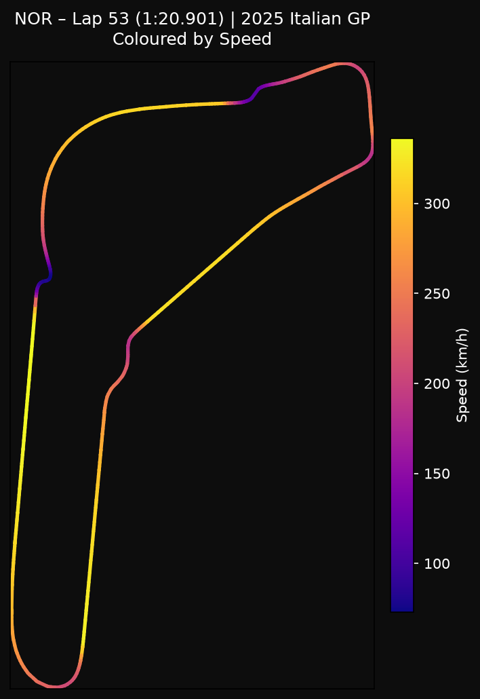
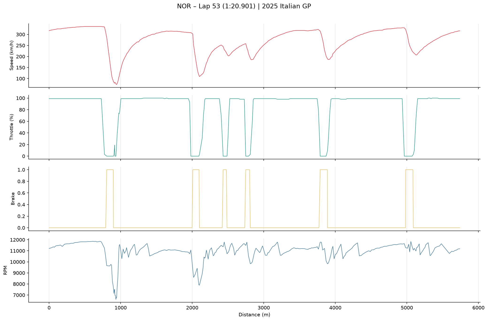

# 🏎️ F1 Lattice Twin

**A data-driven digital twin of a Formula 1 car that predicts tire degradation and the optimal pit window from real race telemetry.**

Every lap, an F1 team has to answer one costly question: *how fast are the tires wearing out, and when should we pit?* Pit too early and you waste track position; pit too late and lap times fall off a cliff. This project rebuilds that decision from the raw data: it fuses each car's sensor streams into a single picture of the car and track, then uses it to model how performance degrades lap by lap.

<p align="center">
  
</p>

<p align="center"><em>Lando Norris's fastest lap of the 2025 Italian Grand Prix (1:20.901), rebuilt from raw position and speed telemetry.<br>Yellow is above 300 km/h; purple marks the heavy braking zones into the chicanes.</em></p>

---

## What's built so far

| Stage | Status | What it does |
|---|---|---|
| **1. Sensor-fusion pipeline** | ✅ Done | Pulls official timing and telemetry through [FastF1](https://docs.fastf1.dev/) and merges car sensors (speed, RPM, throttle, brake, X/Y position) with asynchronous track and air temperature by nearest timestamp |
| **2. Multi-race dataset** | ✅ Done | 2,500+ fused telemetry points across 3 very different 2025 circuits: Monza (high speed), Monaco (slow, technical) and Spa (mixed), plus a Norris vs. Piastri teammate comparison in the same car |
| **3. Exploratory analysis** | ✅ Done | Track maps and channel-by-channel lap traces (below) |
| **4. Model design** | ✅ Done | Architecture and validation plan: [docs/model_architecture.md](docs/model_architecture.md) |
| **5. Tire-degradation and pit-window predictor** | 🔧 In progress | Baseline first (Kalman filter, then gradient boosting), then a small GRU only if it clearly beats the baseline |

## Reading a lap like an engineer



Each corner shows up as the same signature: throttle drops to zero, the brake goes on, speed falls (by more than 250 km/h into Monza's first chicane), and then the driver gets back to full throttle as fast as the tires allow. As the tires wear, these braking and traction phases stretch out. That lap-over-lap drift is the signal the degradation model learns from.

## How the model will work

1. **Fuse:** align every sensor and weather reading onto one timeline per lap
2. **Engineer features:** braking intensity, cornering load (lateral G estimated from the racing line) and lap-time drift against tire age
3. **Predict:** lap-time loss from tire wear, and the probability the car should pit in the next 1–3 laps
4. **Validate honestly:** train on earlier races and test on races the model has never seen, always in time order so future laps can't leak into training

Design choices are deliberately simple-first: a model only earns its place by beating a simpler baseline on races it has not seen.

## Project structure

```
src/         Data pipeline (fetch + fuse) and dataset builder
notebooks/   Exploratory analysis and figures
docs/        Model architecture and learning notes
data/        Generated locally (not committed)
```

## Run it yourself

```bash
python -m venv venv
source venv/bin/activate
pip install -r requirements.txt
python src/build_dataset.py   # downloads race data and builds data/telemetry_dataset.csv
```

---

*Built for fun by [Matt Janas](https://www.linkedin.com/in/mattjanas), a chemical engineer and Michigan Ross MBA candidate, applying the same data-driven modeling I've used to find and fix bottlenecks in manufacturing to my favorite sport.*
